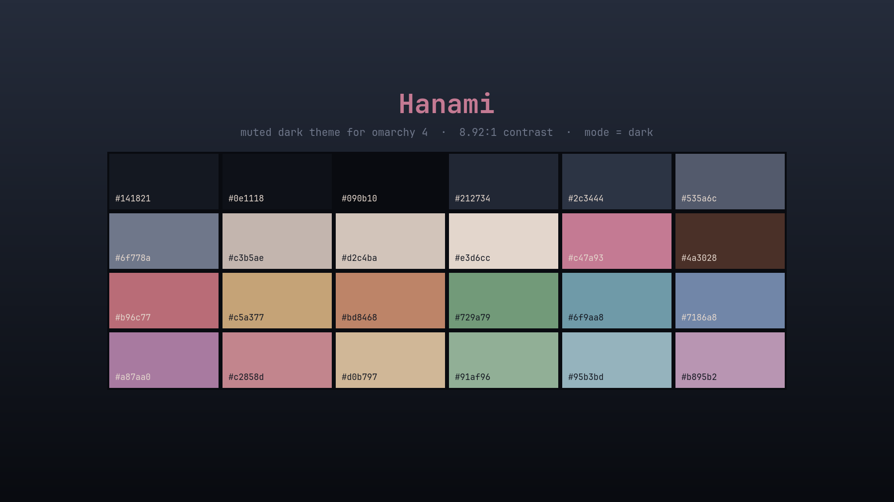

# Hanami

A muted dark theme for [Omarchy](https://omarchy.org) 4 (Quattro), drawn from a pagoda
on a cliff under a moonlit sky, with cherry blossom in the foreground.

The source is a vivid picture. Rather than flatten it, the palette is built from the
image's *shadows* — the foliage and water — with the blossom pink pulled well down in
saturation for the accent, and a warm sunset-tinted foreground. Cool ground, warm
light, exactly as the picture reads.



## Install

```bash
omarchy theme install https://github.com/LizinDev/omarchy-hanami-theme.git
```

Installing applies the theme right away. To switch back to it later, run
`omarchy theme set hanami`; to uninstall it, run `omarchy theme remove hanami`.

## Palette

| Role | Hex | |
|---|---|---|
| background | `#141821` | terminals, bar, popups, menus |
| foreground | `#c3b5ae` | all body text — 8.92:1 on background |
| accent | `#c47a93` | borders, shortcuts, selected rows |
| selection | `#2c3444` | text selection, btop meters |
| muted | `#535a6c` | ANSI bright-black, dividers |

ANSI: `#bd6968` red · `#729a79` green · `#c5a377` yellow · `#7186a8` blue ·
`#a87aa0` magenta · `#6f9aa8` cyan.

Mean ANSI saturation is 0.34 — the blossom pink that dominates the source image sits at
0.84 there and 0.38 here. No ANSI pair is closer than 15.6 ΔE.

## What's here

| File | |
|---|---|
| `colors.toml` | the palette — generates 17 app configs on its own |
| `hyprland.lua` | rose→blue border gradient + a warm shadow on the focused window |
| `shell.{menu,launcher,tooltip,lock}.toml` | per-section shell overrides |
| `icons.theme` | `Yaru-magenta-dark` |
| `backgrounds/` | a palette-derived gradient (see below) |
| `preview.png` | theme-switcher tile |
| `unlock.png` | Plymouth boot splash and SDDM logo |

## Backgrounds

Only `3-hanami-void.png` ships here — a plain gradient generated from the palette. The
theme was designed against a piece of pixel art, but that is someone else's work and is
not redistributed. Drop your own in:

```bash
cp <your-wallpaper> ~/.config/omarchy/themes/hanami/backgrounds/1-hanami.png
omarchy theme set hanami
```

If your wallpaper is a JPEG of pixel art it is probably damaged — JPEG smears hard pixel
edges. Find the native grid by round-tripping (`-filter point` down by N and back up;
lowest RMSE wins, and check the phase on a 1px-offset crop), then:

```bash
magick wall.jpg -statistic median 3x3 -filter point -resize <native>! \
  +dither -colors 192 -filter point -resize <N>00% wall-restored.png
```

Use `median` + point sampling rather than `-filter Box -resize`: Box's support window is
wider than the exact block, so it blends neighbouring native pixels and destroys the
intentional dithering most pixel art uses for gradients.

## Caveats

**Installed from a git clone, this theme loses `hyprland.lua`.** Omarchy drops every
`.lua`, terminal config and `vscode.json` from a cloned theme, because each names
something to run. The palette and the border gradient survive; the window shadows do not.

**`shell.*.toml` overrides replace their whole section, they don't merge.** Each file
here restates the complete section, and its hex values are frozen copies of
`colors.toml`. Re-sync them if you change the palette.

## Working on it

Keep the repo outside `~/.config/omarchy/themes` and symlink it in. A directory with a
`.git` inside is treated as somebody else's theme and staged under restrictions; a
symlink is not.

```bash
git clone <this-repo> ~/Projects/omarchy-hanami-theme
ln -s ~/Projects/omarchy-hanami-theme ~/.config/omarchy/themes/hanami
omarchy theme set hanami
```

Iterate with `omarchy theme refresh`.

## License

The theme files are released under the [MIT License](LICENSE). The pixel art the palette
was designed against is someone else's work. It is not in this repository and the
license does not cover it.
